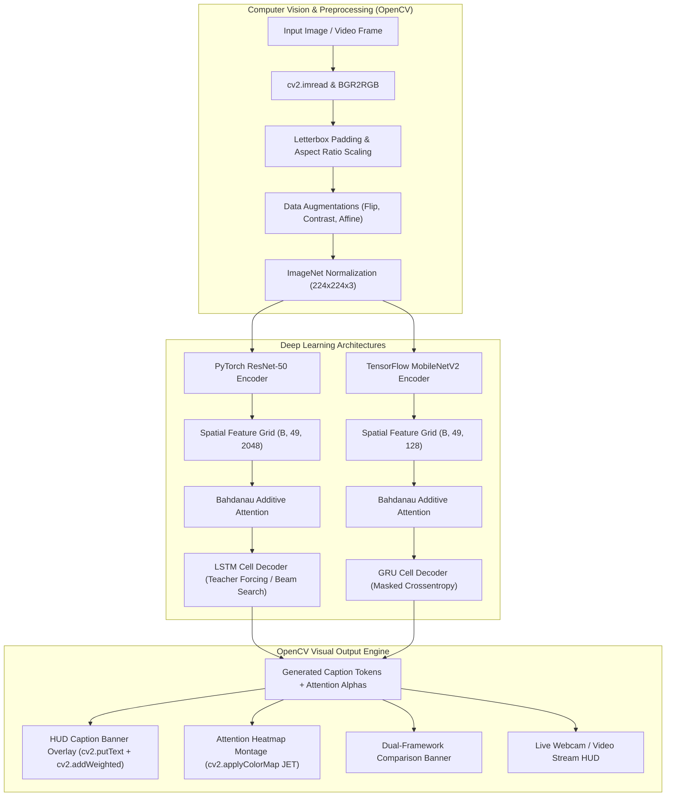

# 📸 Deep Learning Image Captioning with OpenCV, PyTorch & TensorFlow

[](https://www.python.org/downloads/)
[](https://pytorch.org/)
[](https://tensorflow.org/)
[](https://opencv.org/)

An end-to-end, production-ready **Image Captioning** system combining **Computer Vision (OpenCV)** and modern **Deep Learning Frameworks (PyTorch & TensorFlow)**. This project demonstrates how computer vision preprocessing, spatial feature extraction, Bahdanau additive attention, and sequence decoding come together in a unified architecture.

---

## 🌟 Key Highlights

- **Dual Deep Learning Backends**:
  - **PyTorch Pipeline**: Pretrained ResNet-50 spatial encoder + Bahdanau Additive Attention + LSTM decoder with Teacher Forcing and Beam Search.
  - **TensorFlow / Keras Pipeline**: MobileNetV2 feature extractor + Bahdanau Attention Layer + GRU decoder with custom `tf.GradientTape` training and `tf.data` input pipeline.
- **Computer Vision with OpenCV (`cv2`)**:
  - High-speed image loading, letterbox aspect-ratio preserving padding, and color transformations.
  - Computer vision augmentations (random horizontal flips, contrast/brightness adjustments, affine shears).
  - Attention Map Visualizer: Upscales spatial attention grids ($7 \times 7$) to full resolution, applies `COLORMAP_JET`, and blends transparent heatmaps for each decoded token.
  - Heads-Up Display (HUD) Banner Overlay: Word-wrapped caption rendering, confidence score badges, and semi-transparent aesthetic backgrounds.
  - Live Webcam / Video Stream Captioning: Captures live video, tracks FPS, and renders caption overlays in real time.
- **Cross-Framework Bridge**:
  - Side-by-side inference benchmarking (latency in ms and output comparison).
  - Dual-banner comparative visualizer rendering PyTorch and TensorFlow outputs onto one unified image.
- **Zero-Dependency Quickstart**:
  - Built-in OpenCV synthetic dataset generator allows training and running inference immediately out-of-the-box without needing to download multi-gigabyte datasets first.
  - Full support for standard benchmark datasets (**Flickr8k**, **Flickr30k**, **MS COCO**).

---

## 🏛️ System Architecture



---

## 📁 Project Structure

```
Image-Captioning/
├── config.py                 # Central configuration (hyperparameters, paths, CV constants)
├── requirements.txt          # Python dependencies
├── src/
│   ├── __init__.py
│   ├── vocab.py              # Vocabulary tokenizer, numericalizer, JSON serialization
│   ├── opencv_utils.py       # OpenCV preprocessing, augmentations, overlays & heatmaps
│   ├── dataset.py            # PyTorch Dataset/Collate & TensorFlow tf.data pipelines
│   ├── metrics.py            # BLEU-1, BLEU-2, BLEU-3, BLEU-4 evaluation
│   ├── bridge.py             # Cross-framework benchmarking & side-by-side visualization
│   └── models/
│       ├── __init__.py
│       ├── pytorch_captioner.py # PyTorch ResNet50 + Bahdanau Attention + LSTM
│       └── tf_captioner.py      # TensorFlow MobileNetV2 + Attention + GRU
├── train_pytorch.py          # PyTorch training script with validation & checkpointing
├── train_tf.py               # TensorFlow training script with tf.data & weight saving
├── predict.py                # CLI inference tool with OpenCV visual overlay & heatmaps
├── live_cam.py               # Real-time webcam / video file captioning HUD demo
├── demo_quickstart.py        # 1-Click self-contained end-to-end verification script
└── outputs/                  # Directory for generated captioned images & heatmaps
```

---

## 🚀 Quickstart Guide

### 1. Installation

Activate your virtual environment and install dependencies:

```bash
pip install -r requirements.txt
```

### 2. Run the 1-Minute End-to-End Demo

Run the self-contained quickstart demo. It automatically creates OpenCV test images, builds the vocabulary, trains both models, computes BLEU scores, and generates output visual artifacts:

```bash
python demo_quickstart.py
```

### 3. Launch the Interactive Web Studio 🌐

Launch the modern Web Dashboard in your browser:

```bash
python app.py
```
Open **[http://127.0.0.1:5000](http://127.0.0.1:5000)** in any web browser to:
- Drag & drop or upload your own images.
- Select from built-in OpenCV sample images.
- Choose between **PyTorch**, **TensorFlow**, or **Side-by-Side Comparison**.
- Inspect generated captions, OpenCV HUD overlays, and spatial **Attention Heatmap** grids in real time (~40ms latency).

Generated outputs will be saved in `outputs/`:
- `demo_pytorch_caption.jpg`: Captioned image with PyTorch ResNet-50 HUD banner.
- `demo_tensorflow_caption.jpg`: Captioned image with TensorFlow MobileNetV2 HUD banner.
- `demo_attention_heatmaps.jpg`: Step-by-step spatial attention heatmap montage.
- `demo_cross_framework_comparison.jpg`: Side-by-side PyTorch vs TensorFlow benchmark.

---

## 🛠️ Usage & CLI Tools

### Single Image Captioning & OpenCV Visualization (`predict.py`)

Generate a caption for any image using PyTorch Beam Search and generate attention heatmaps:

```bash
python predict.py --image data/samples/dog_park.jpg --framework pytorch --method beam --beam_width 3 --attention
```

Compare PyTorch and TensorFlow outputs on the same image with latency benchmarks:

```bash
python predict.py --image data/samples/red_car.jpg --framework both
```

**CLI Arguments:**
- `--image`: Path to input image (`.jpg`, `.png`).
- `--framework`: `pytorch`, `tensorflow`, or `both`.
- `--method`: PyTorch decoding strategy (`beam` or `greedy`).
- `--beam_width`: Beam search width (default: 3).
- `--attention`: Generate step-by-step attention heatmap grid.
- `--output`: Custom output file path.

---

### Real-Time Webcam / Video Captioning (`live_cam.py`)

Run real-time video captioning with a live OpenCV Heads-Up Display (HUD):

```bash
# Webcam 0
python live_cam.py --source 0

# Video file
python live_cam.py --source /path/to/video.mp4
```

**Interactive Keyboard Controls:**
- `q`: Quit stream.
- `s`: Save current captioned snapshot to `outputs/`.
- `m`: Switch active deep learning framework (PyTorch $\leftrightarrow$ TensorFlow).

---

### Training Models

#### PyTorch Model Training:
```bash
python train_pytorch.py --data_file data/captions.json --epochs 10 --batch_size 16 --lr 4e-4
```

#### TensorFlow Model Training:
```bash
python train_tf.py --data_file data/captions.json --epochs 10 --batch_size 16 --lr 4e-4
```

---

## 📊 Benchmark Datasets Support

The project natively supports standard image-captioning datasets:

1. **Flickr8k / Flickr30k**:
   - Place images in `data/Flicker8k_Dataset/`.
   - Place annotations in `data/captions.txt` formatted as:
     ```csv
     image,caption
     1000268201_693b08cb0e.jpg,A child in a pink dress is climbing up a set of stairs.
     ```
   - Run: `python train_pytorch.py --data_file data/captions.txt`

2. **MS COCO**:
   - Convert annotations into JSON format:
     ```json
     [
       {
         "image_path": "data/train2017/000000000009.jpg",
         "captions": ["a bowl of food on a table", "a breakfast meal served fresh"]
       }
     ]
     ```
   - Run: `python train_pytorch.py --data_file data/coco_captions.json`

---

## 🔬 Deep Learning Details

### 1. Bahdanau Attention Formulation
For spatial image features $V = \{v_1, \dots, v_{49}\} \subset \mathbb{R}^{D}$ and decoder hidden state $h_t \in \mathbb{R}^{H}$:
$$e_{t, i} = v_a^T \tanh(W_v v_i + W_h h_t)$$
$$\alpha_{t, i} = \frac{\exp(e_{t, i})}{\sum_{k=1}^{49} \exp(e_{t, k})}$$
$$c_t = \sum_{i=1}^{49} \alpha_{t, i} v_i$$

### 2. Doubly Stochastic Attention Regularization
To encourage the attention mechanism to attend equally to every region of the image across the generation process, we include an attention regularizer in PyTorch:
$$\mathcal{L}_{\text{total}} = \mathcal{L}_{\text{CE}} + \lambda \sum_{i=1}^{49} \left(1 - \sum_{t=1}^{T} \alpha_{t, i}\right)^2$$

---

## 📝 License

Distributed under the MIT License.
